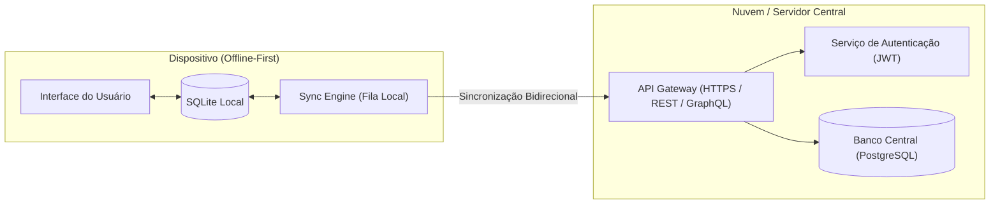

# APIs e Integrações

Este documento analisa a comunicação externa do aplicativo **Império das Sedas**, suas integrações com módulos nativos e diretrizes de arquitetura para conectividade e sincronização em nuvem futuras.

---

## 1. Estado Atual de Comunicação Externa

No estágio atual de desenvolvimento, **o aplicativo opera 100% de forma local e offline-first**. 

- **Endpoints Remotos:** Não há chamadas HTTP ativas (`fetch`, `axios` ou GraphQL) para servidores web ou microsserviços externos.
- **Autenticação Externa:** Não há sistema de login remoto, OAuth ou verificação de sessão em nuvem implementado.
- **Armazenamento:** Todo o estado persistente é armazenado no dispositivo através do SQLite local (`imperio_das_sedas.db`).

Essa abordagem garante velocidade máxima de resposta, operação sem necessidade de conexão com a internet e privacidade absoluta dos dados de inventário local.

---

## 2. Integrações de Módulos de Plataforma

Embora não se comunique com servidores web no momento, o aplicativo integra-se profundamente com módulos nativos do ecossistema Expo e React Native:

| Módulo Integrado | Tipo de Integração | Responsabilidade |
| :--- | :--- | :--- |
| `expo-sqlite` | Driver C++ / WebAssembly | Ponte de comunicação com a engine SQLite no sistema operacional do dispositivo (Android/iOS) e IndexedDB na Web. |
| `react-native-safe-area-context` | Bridge Nativa | Consulta os limites seguros da tela física (status bar, home indicator, câmeras embutidas e entalhes) para ajuste do padding. |
| `@react-navigation/native` | Gerenciador de Janelas | Interage com a pilha de janelas nativas no Android/iOS (`react-native-screens`) para transições fluidas e hardware back button. |
| `@expo/vector-icons` | Bundling de Fontes | Carrega a tipografia vetorial dos ícones Ionicons de forma assíncrona durante a inicialização. |

---

## 3. Diretrizes para Integração Futura com Backend (Cloud Sync)

Para expansão futura do aplicativo visando sincronização multi-dispositivo ou integração com sistemas ERP/E-commerce, recomenda-se a seguinte estrutura:

### Recomendações Técnicas:
1. **Controle de Versão de Registros:** Adicionar coluna `versao INTEGER DEFAULT 1` e `sincronizado_em TEXT` em todas as tabelas locais.
2. **Armazenamento Seguro de Tokens:** Utilizar a biblioteca `expo-secure-store` para guardar chaves JWT ou credenciais de API, nunca gravando senhas ou tokens em texto plano no SQLite ou `AsyncStorage`.
3. **Resolução de Conflitos:** Adotar a abordagem *Timestamp-based Last-Write-Wins* (LWW) para atualizações de cadastro de produtos ou filas de eventos de movimentação imutáveis (*Event Sourcing*), onde cada saída ou entrada é tratada como um evento de log impossível de ser sobrescrito acidentalmente.

