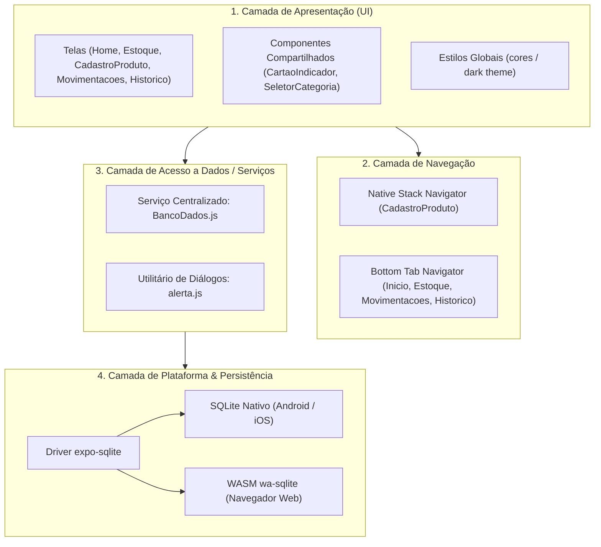
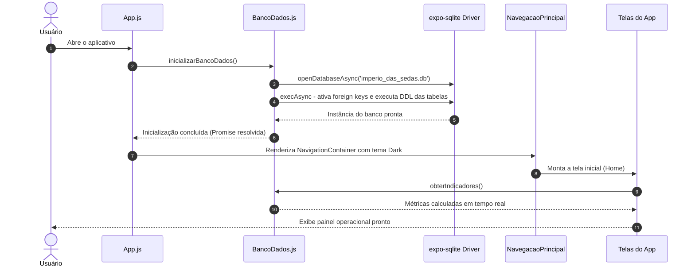

# Arquitetura do Sistema

Este documento descreve as decisões arquiteturais, o modelo em camadas e as estratégias de engenharia adotadas no desenvolvimento do aplicativo **Império das Sedas**.

---

## 1. Visão Geral da Arquitetura

O sistema é construído como um aplicativo **Client-Side Offline-First**, executado sobre o runtime do React Native e orquestrado pelo ecossistema do Expo SDK 57. Não há dependência direta de uma API remota para operações essenciais: todo o estado persistente é gerenciado localmente através de um banco de dados relacional **SQLite** incorporado ao dispositivo do usuário.

### Modelo em Camadas (Layered Architecture)

A aplicação adota uma separação clara de responsabilidades dividida em quatro camadas principais:

---

## 2. Detalhamento das Camadas

### 2.1. Camada de Apresentação (UI)
- **Localização:** [`src/telas/`](file:///d:/Downloads/imperio_das_sedas-main/imperio_das_sedas-main/src/telas) e [`src/componentes/`](file:///d:/Downloads/imperio_das_sedas-main/imperio_das_sedas-main/src/componentes).
- **Responsabilidade:** Renderização dos elementos de interface, gerenciamento do estado local da tela (`useState`), recepção de eventos do usuário e despacho de operações para o banco.
- **Isolamento:** As telas não constroem queries SQL diretamente nem manipulam a instância do SQLite bruta. Toda e qualquer interação com dados é feita consumindo funções especializadas importadas de [`src/banco/BancoDados.js`](file:///d:/Downloads/imperio_das_sedas-main/imperio_das_sedas-main/src/banco/BancoDados.js).

### 2.2. Camada de Navegação
- **Localização:** [`src/navegacao/NavegacaoPrincipal.js`](file:///d:/Downloads/imperio_das_sedas-main/imperio_das_sedas-main/src/navegacao/NavegacaoPrincipal.js).
- **Responsabilidade:** Controle de rotas e pilhas de visualização.
- **Estrutura:**
  - `MenuPrincipal`: Navegador inferior por abas (`BottomTabNavigator`) que organiza os 4 painéis operacionais (`Inicio`, `Estoque`, `Movimentacoes`, `Historico`).
  - `NavegacaoPrincipal`: Navegador raiz por pilha (`NativeStackNavigator`) que sobrepõe a tela modal/secundária `CadastroProduto` mantendo a experiência fluida sem poluição visual.

### 2.3. Camada de Persistência e Regras de Negócio
- **Localização:** [`src/banco/BancoDados.js`](file:///d:/Downloads/imperio_das_sedas-main/imperio_das_sedas-main/src/banco/BancoDados.js).
- **Responsabilidade:**
  - Ciclo de vida da conexão com o arquivo SQLite (`imperio_das_sedas.db`).
  - Execução de DDL (`CREATE TABLE`, criação de índices e verificação de foreign keys).
  - Execução de transações ACID atômicas (`executarTransacao`).
  - Encapsulamento de regras de integridade (ex: proibição de exclusão de produtos com histórico de movimentações atrelado).
  - Tratamento de parâmetros e prevenção estrita de *SQL Injection* por meio de queries parametrizadas.

### 2.4. Camada de Suporte Multiplataforma
- **Localização:** [`src/util/alerta.js`](file:///d:/Downloads/imperio_das_sedas-main/imperio_das_sedas-main/src/util/alerta.js) e [`metro.config.js`](file:///d:/Downloads/imperio_das_sedas-main/imperio_das_sedas-main/metro.config.js).
- **Responsabilidade:** Abstrair diferenças críticas entre ambientes móveis nativos e a web:
  - **Alertas e Diálogos:** O componente `Alert.alert` do React Native não tem suporte nativo na web (`react-native-web`). A função `mostrarAlerta` unifica as chamadas, chaveando automaticamente para `window.alert` / `window.confirm` na web e mantendo `Alert.alert` seguro com botões obrigatórios no Android/iOS.
  - **Assets WebAssembly:** O Metro Bundler foi estendido para incluir a extensão `.wasm` na lista de assets, permitindo o carregamento do binário `wa-sqlite.wasm` em navegadores.
  - **Transações Web:** No driver WebAssembly do `expo-sqlite`, chamadas manuais a `BEGIN`/`COMMIT` em workers podem sofrer contenção de statements; a camada detecta `Platform.OS === 'web'` e ajusta a execução sequencial com segurança.

---

## 3. Fluxo de Execução da Aplicação

O ciclo de vida do aplicativo inicia em [`index.js`](file:///d:/Downloads/imperio_das_sedas-main/imperio_das_sedas-main/index.js), passando pelo componente raiz [`App.js`](file:///d:/Downloads/imperio_das_sedas-main/imperio_das_sedas-main/App.js):

---

## 4. Estratégia de Atualização de Dados (Focus Effect)

Ao alternar entre abas no React Navigation, as telas não são desmontadas por padrão. Para garantir que qualquer alteração realizada em uma tela (por exemplo, uma nova movimentação ou a edição de um produto) seja refletida imediatamente nas demais abas sem necessidade de reinicializar a aplicação:

1. Todas as telas consom o hook `useFocusEffect` do `@react-navigation/native`.
2. As funções de busca (`carregarProdutos`, `carregarHistorico`, `obterIndicadores`) são memorizadas com `useCallback`.
3. Sempre que o usuário foca na aba, o hook é acionado e os dados mais recentes são lidos diretamente do SQLite.

