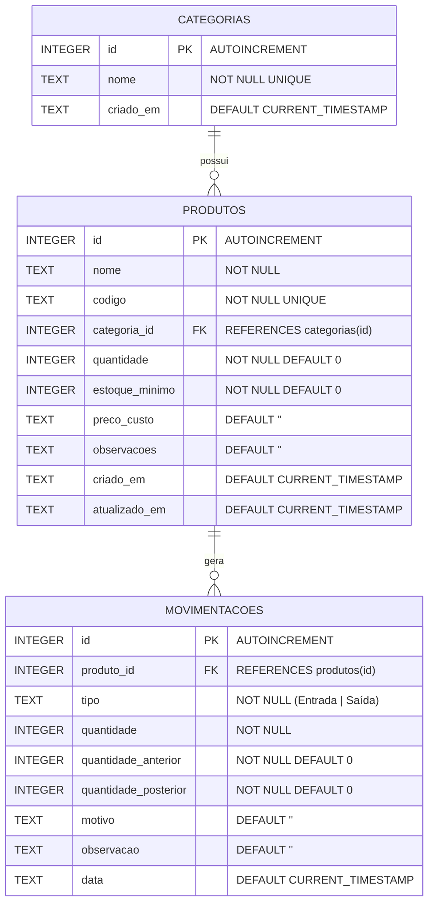

# Banco de Dados SQLite

Este documento detalha o modelo de dados relacional, o esquema físico das tabelas, as restrições de integridade, o isolamento transacional e o catálogo de funções disponíveis em [`src/banco/BancoDados.js`](file:///d:/Downloads/imperio_das_sedas-main/imperio_das_sedas-main/src/banco/BancoDados.js).

---

## 1. Tecnologia e Conexão

- **Mecanismo:** SQLite incorporado.
- **Biblioteca cliente:** `expo-sqlite` (`~57.0.4`), utilizando as APIs modernas baseadas em Promises (`openDatabaseAsync`, `execAsync`, `getAllAsync`, `getFirstAsync`, `runAsync`, `withTransactionAsync`).
- **Nome do arquivo de banco:** `imperio_das_sedas.db`.
- **Modo Web:** Em ambiente navegador, o SQLite opera compilado para WebAssembly (`wa-sqlite`) sobre IndexedDB/Origin-Private-FileSystem (OPFS).
- **Integridade Referencial:** No momento da inicialização, o comando `PRAGMA foreign_keys = ON;` é executado explicitamente para garantir que constraints `REFERENCES` sejam respeitadas pelo motor relacional.

---

## 2. Diagrama Entidade-Relacionamento (ER)



---

## 3. Esquema Físico das Tabelas (DDL)

### 3.1. Tabela `categorias`
Armazena os grupos de produtos de forma personalizada e extensível:

```sql
CREATE TABLE IF NOT EXISTS categorias (
  id INTEGER PRIMARY KEY AUTOINCREMENT,
  nome TEXT NOT NULL UNIQUE,
  criado_em TEXT DEFAULT CURRENT_TIMESTAMP
);
```

### 3.2. Tabela `produtos`
Registra os produtos, seu código único (SKU) e os parâmetros de controle de estoque:

```sql
CREATE TABLE IF NOT EXISTS produtos (
  id INTEGER PRIMARY KEY AUTOINCREMENT,
  nome TEXT NOT NULL,
  codigo TEXT NOT NULL UNIQUE,
  categoria_id INTEGER REFERENCES categorias(id),
  quantidade INTEGER NOT NULL DEFAULT 0,
  estoque_minimo INTEGER NOT NULL DEFAULT 0,
  preco_custo TEXT DEFAULT '',
  observacoes TEXT DEFAULT '',
  criado_em TEXT DEFAULT CURRENT_TIMESTAMP,
  atualizado_em TEXT DEFAULT CURRENT_TIMESTAMP
);
```

### 3.3. Tabela `movimentacoes`
Tabela de auditoria imutável que registra cada alteração física de quantidade:

```sql
CREATE TABLE IF NOT EXISTS movimentacoes (
  id INTEGER PRIMARY KEY AUTOINCREMENT,
  produto_id INTEGER NOT NULL REFERENCES produtos(id),
  tipo TEXT NOT NULL,
  quantidade INTEGER NOT NULL,
  quantidade_anterior INTEGER NOT NULL DEFAULT 0,
  quantidade_posterior INTEGER NOT NULL DEFAULT 0,
  motivo TEXT DEFAULT '',
  observacao TEXT DEFAULT '',
  data TEXT DEFAULT CURRENT_TIMESTAMP
);
```

---

## 4. Gestão de Transações e Multiplataforma

Operações que alteram mais de uma tabela simultaneamente (ex: registrar movimentação e atualizar o saldo do produto correspondente) são executadas sob **transações atômicas**.

Para garantir compatibilidade com o ecossistema Web (onde chamadas aninhadas a `withTransactionAsync` no Web Worker do `wa-sqlite` podem causar bloqueios por contenção de cursores), foi desenvolvida a função interna `executarTransacao`:

```javascript
async function executarTransacao(tarefa) {
  if (Platform.OS === 'web') {
    return await tarefa();
  }
  return await db.withTransactionAsync(tarefa);
}
```

---

## 5. Catálogo de Funções Exportadas

| Função | Parâmetros | Retorno | Descrição |
| :--- | :--- | :--- | :--- |
| `inicializarBancoDados()` | Nenhum | `Promise<SQLiteDatabase>` | Garante abertura do banco e criação DDL sob padrão Singleton protegido contra condições de corrida (*Race Conditions*). |
| `listarProdutos()` | Nenhum | `Promise<Array<Object>>` | Retorna todos os produtos ordenados por nome com `LEFT JOIN` na tabela de categorias. |
| `buscarProdutoPorId(id)` | `id` (Number) | `Promise<Object \| null>` | Retorna os detalhes de um único produto ou `null` se inexistente. |
| `cadastrarProduto(dados)` | `{ nome, codigo, categoria, quantidade, estoqueMinimo, precoCusto, observacoes }` | `Promise<Number>` | Cria categoria se inexistente, insere produto e, caso a quantidade inicial seja > 0, cria automaticamente movimentação de "Entrada" com motivo "Cadastro inicial". |
| `atualizarProduto(id, dados)`| `id` (Number), `dados` (Object) | `Promise<Number>` | Atualiza todos os campos do produto e atualiza o timestamp `atualizado_em`. |
| `excluirProduto(id)` | `id` (Number) | `Promise<Number>` | **Protegida:** Verifica se existem movimentações associadas. Lança erro se houver histórico; caso contrário, remove o registro. |
| `registrarEntrada(id, qtd, motivo, obs)` | `produtoId`, `quantidade`, `motivo`, `observacao` | `Promise<Number>` | Em transação: lê saldo anterior, calcula saldo posterior (`qtdAnterior + qtd`), grava auditoria e atualiza `produtos.quantidade`. |
| `registrarSaida(id, qtd, motivo, obs)` | `produtoId`, `quantidade`, `motivo`, `observacao` | `Promise<Number>` | Em transação: valida se `qtdSaida <= qtdAnterior`. Lança `"Estoque insuficiente."` se violado; caso válido, grava auditoria e deduz o saldo. |
| `listarMovimentacoes(filtros)`| `filtros` `{ tipo, busca }` | `Promise<Array<Object>>` | Retorna histórico ordenado por data decrescente com data formatada no padrão brasileiro (`DD/MM/AAAA HH:mm`). |
| `listarCategorias()` | Nenhum | `Promise<Array<{id, nome}>>` | Retorna todas as categorias cadastradas ordenadas alfabeticamente. |
| `cadastrarCategoria(nome)` | `nome` (String) | `Promise<Number>` | Insere nova categoria com `INSERT OR IGNORE` e retorna o respectivo `id`. |
| `excluirCategoria(id)` | `id` (Number) | `Promise<Number>` | **Protegida:** Impede a exclusão se houver produtos vinculados à categoria. |
| `obterIndicadores()` | Nenhum | `Promise<Object>` | Calcula em tempo real: total de produtos, produtos em estoque baixo, contagem de entradas no mês corrente, saídas no mês corrente e top 5 produtos críticos. |
| `buscarProdutos(termo)` | `termo` (String) | `Promise<Array<Object>>` | Consulta produtos por aproximação textual (`LIKE %termo%`). |

---

## 6. Regras de Integridade e Auditoria

1. **Unicidade de Código (SKU):** A coluna `codigo` possui restrição `UNIQUE`. Duplicidades geram exceção SQLite tratada com aviso amigável ao usuário.
2. **Auditoria de Quantidade:** A tabela `movimentacoes` não apenas armazena a quantidade adicionada ou removida, mas registra o saldo exato antes (`quantidade_anterior`) e depois (`quantidade_posterior`), permitindo reconstruir e auditar o histórico de qualquer item mesmo diante de alterações posteriores.
3. **Bloqueio de Exclusão com Histórico:** Produtos associados a movimentações não podem ser deletados. Essa regra garante conformidade contábil e operacional, evitando referências órfãs.

