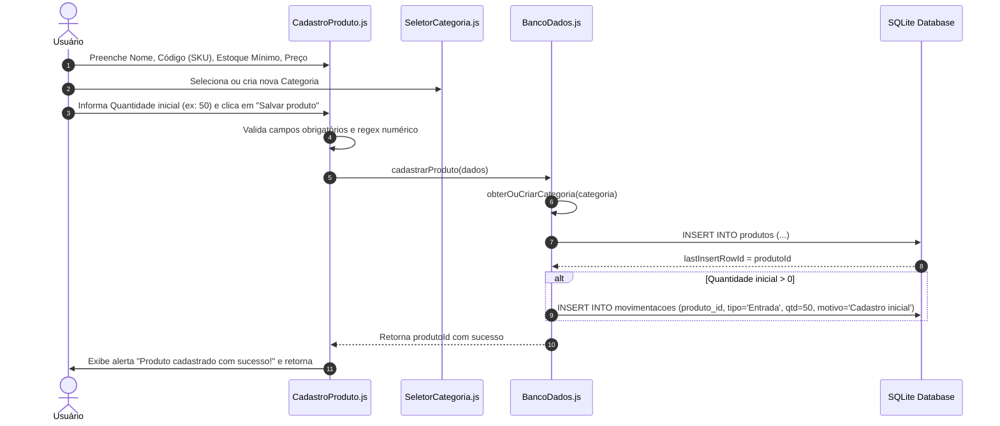
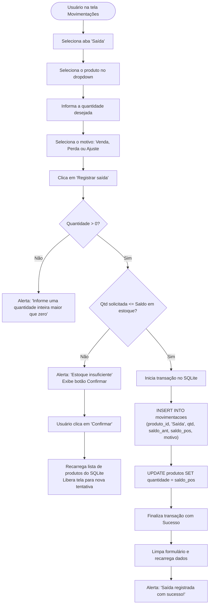
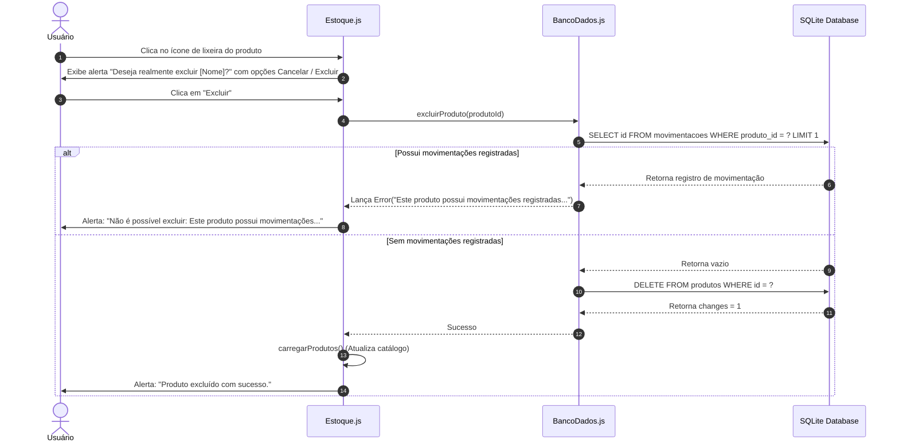

# Fluxos do Sistema

Este documento descreve detalhadamente os principais fluxos operacionais do aplicativo **Império das Sedas**, mapeando o comportamento passo a passo desde o disparo da ação pelo usuário até a persistência no banco de dados.

---

## 1. Fluxo de Cadastro de Produto

O cadastro de produto contempla tanto a resolução dinâmica de categorias quanto a criação automática da movimentação de entrada inicial caso o saldo seja maior que zero:

---

## 2. Fluxo de Movimentação de Estoque (Saída de Mercadoria)

Este fluxo ilustra a proteção contra estoque negativo, a transação atômica e o mecanismo de confirmação amigável:

---

## 3. Fluxo de Exclusão Protegida de Produto

O sistema implementa uma salvaguarda contra quebra de histórico contábil e referências órfãs:

---

## 4. Fluxo de Cálculo de Indicadores do Dashboard (Home)

Toda vez que a tela principal ganha foco, a função `obterIndicadores()` computa estatísticas consolidadas em tempo real:

1. **Total de Produtos:** `SELECT COUNT(*) AS total FROM produtos;`
2. **Estoque Baixo:** `SELECT COUNT(*) AS total FROM produtos WHERE quantidade > 0 AND quantidade <= estoque_minimo;`
3. **Entradas no Mês:** `SELECT COUNT(*) FROM movimentacoes WHERE tipo = 'Entrada' AND strftime('%Y-%m', data) = 'AAAA-MM';`
4. **Saídas no Mês:** `SELECT COUNT(*) FROM movimentacoes WHERE tipo = 'Saída' AND strftime('%Y-%m', data) = 'AAAA-MM';`
5. **Top 5 Produtos Críticos:** Busca os 5 produtos com menor quantidade positiva dentro do limite mínimo para exibição na seção de alerta imediato.

