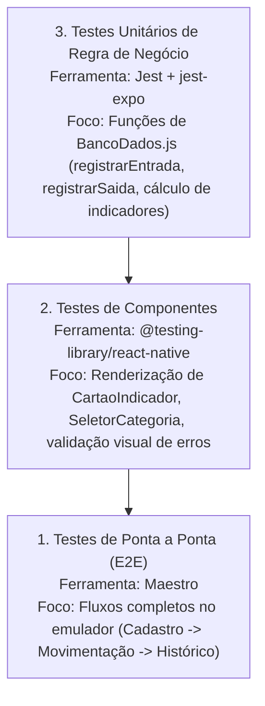

# Testes e Manutenção

Este documento apresenta o diagnóstico da cobertura de testes atual do projeto **Império das Sedas**, as rotinas de verificação estática disponíveis e o plano recomendado para implementação de testes automatizados e sustentabilidade da base de código.

---

## 1. Diagnóstico do Estado Atual

- **Testes Automatizados de Unidade/Integração:** Inexistentes no momento. O arquivo [`package.json`](file:///d:/Downloads/imperio_das_sedas-main/imperio_das_sedas-main/package.json) não possui dependências de testes (como `jest`, `jest-expo` ou `@testing-library/react-native`).
- **Testes de Ponta a Ponta (E2E):** Inexistentes. Não há automação configurada com ferramentas como Detox, Appium ou Maestro.
- **Análise Estática de Código:** Presente através do **ESLint 9** com a configuração oficial `eslint-config-expo/flat` em [`eslint.config.js`](file:///d:/Downloads/imperio_das_sedas-main/imperio_das_sedas-main/eslint.config.js).
- **Tipagem Estática:** O projeto possui `typescript` e `@types/react` instalados como dependências de desenvolvimento, permitindo checagem estática de tipos.

---

## 2. Rotinas de Verificação Estática Disponíveis

Antes de realizar novos commits ou compilações de release, recomenda-se a execução das seguintes rotinas no terminal:

### 2.1. Linter de Código
Verifica convenções de código, hooks do React e boas práticas:
```bash
npm run lint
```

### 2.2. Verificação de Integridade das Dependências
Analisa incompatibilidades entre pacotes e a versão do Expo SDK:
```bash
npx expo-doctor
```

### 2.3. Checagem de Sintaxe JavaScript
Pode-se validar a compilação Babel de todos os arquivos JS sem executar a aplicação:
```bash
node -c App.js index.js
```

---

## 3. Plano Recomendado de Testes Automatizados

Para garantir que novas alterações não causem regressões em regras de negócio cruciais (como controle de saldo e integridade de exclusão), recomenda-se a estruturação da seguinte pirâmide de testes:



### 3.1. Estrutura Recomendada para Testes Unitários do Banco
Adicionar `jest` e `jest-expo`:
```bash
npx expo install -- --save-dev jest jest-expo @testing-library/react-native @testing-library/jest-native
```

Exemplo de caso de teste para `registrarSaida`:
```javascript
// __tests__/BancoDados.test.js (Exemplo recomendado)
describe('Regras de Negócio do Estoque', () => {
  it('deve impedir saída com quantidade superior ao saldo em estoque', async () => {
    // 1. Cadastrar produto de teste com 5 unidades
    // 2. Tentar registrar saída de 10 unidades
    // 3. Esperar que a promessa seja rejeitada com o erro 'Estoque insuficiente.'
  });

  it('deve atualizar o saldo e criar auditoria corretamente ao registrar entrada', async () => {
    // 1. Cadastrar produto com 10 unidades
    // 2. Registrar entrada de 5 unidades
    // 3. Verificar se produtos.quantidade passou a 15
    // 4. Verificar se movimentacoes registrou saldo_anterior=10 e saldo_posterior=15
  });
});
```

---

## 4. Diretrizes para Manutenção do Código

1. **Centralização de SQL:** Nunca escreva consultas SQL dentro de componentes ou telas. Toda nova operação deve ser adicionada como uma função pura assíncrona em [`src/banco/BancoDados.js`](file:///d:/Downloads/imperio_das_sedas-main/imperio_das_sedas-main/src/banco/BancoDados.js).
2. **Design Tokens:** Não utilize cores fixas em hexadecimal espalhadas pelo código. Importe sempre o objeto `cores` de [`src/estilo/style.js`](file:///d:/Downloads/imperio_das_sedas-main/imperio_das_sedas-main/src/estilo/style.js) para assegurar uniformidade visual.
3. **Multiplataforma nos Diálogos:** Sempre invoque `mostrarAlerta` de [`src/util/alerta.js`](file:///d:/Downloads/imperio_das_sedas-main/imperio_das_sedas-main/src/util/alerta.js) em vez de `Alert.alert` bruto, garantindo suporte transparente na Web e resiliência no Android.

